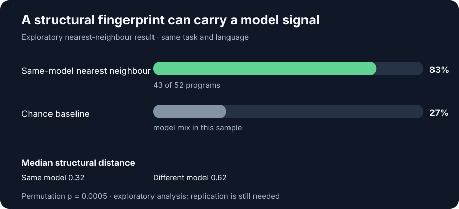
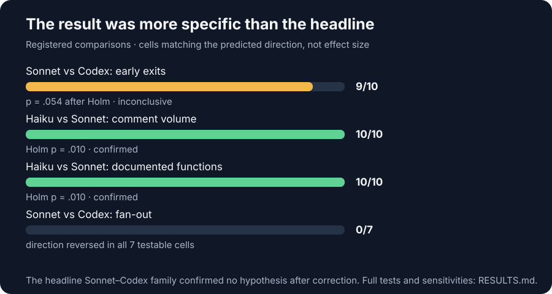

# Do AI coding agents have habits you can measure?

> **The short version.** We gave three agent/model configurations two programming tasks in five languages and asked whether their code carried measurable structural habits. Across 60 fresh runs, 59 programs passed the final held-out checks. We registered the hypotheses before collecting these runs. The original Sonnet-versus-Codex predictions did not survive statistical correction. Instead, Haiku and Sonnet showed distinct, repeatable patterns in comments and function documentation. A separate exploratory analysis found that structural fingerprints could identify the generating model's nearest same-task, same-language neighbour in 43 of 52 cases.

I began this study expecting to find a clear Claude-versus-Codex contrast. The first exploration seemed to point that way. Then we wrote down the predictions, fixed the analysis, and ran a fresh set of programs. The headline comparison did not hold up after correction. That was disappointing for about a minute. Then the more interesting result became visible: the habits were specific to model configurations, not a simple vendor divide.

This README is the front door to the study; the repository is the evidence package. The story, figures, preregistration, run records, programs, measurement code, validity checks, and result tables live together so a reader can move from a claim to the evidence behind it.

## What we did

Each configuration received the same UCI chess-engine and DPLL SAT-solver tasks in C, Java, Python, Rust, and COBOL, in fresh environments without human steering. Claude Code ran Sonnet 5.5 and Haiku 5.5 in two independent rounds; Codex CLI ran gpt-6-luna in one. We measured program structure with [GitGalaxy](https://github.com/squid-protocol/gitgalaxy), without AST-based extraction or an LLM classifier. The preregistered predictions were adapted from an earlier exploratory study of human-steered agent runs.

- **60 fresh runs** across 3 agent/model configurations, 2 tasks, and 5 languages
- **59 of 60 programs passed** the final held-out check; 57 passed on the first check
- **Every hypothesis and decision rule was preregistered** before confirmation data existed
- **Structural measurement checked independently** against Tree-sitter and ctags

## A structural fingerprint

For each program, we compared its GitGalaxy structural profile with programs for the same task and language. Its nearest neighbour came from the same model in **43 of 52 cases (83%)**, against a 27% chance baseline. This is an exploratory attribution result, not a trained classifier and not yet a replicated finding. The planned next step is fresh-run replication, including a new task.

The distance comparison helps explain the result: two runs from the same model had a median structural distance of 0.32, compared with 0.62 between different models working on the same task and language. Language itself moved the profile more than task or model, which is why these comparisons hold task and language constant.

## The preregistered result was not the expected result

The headline Sonnet-versus-Codex family confirmed no hypothesis after Holm correction. Codex's early-exit pattern came closest: it pointed in the predicted direction in 9 of 10 cells, but its adjusted p-value was 0.054. The exploratory fan-out prediction reversed in every testable cell.

A different comparison did produce clear results. Haiku had more comment lines than Sonnet in all 10 cells and documented a larger share of functions in all 10; it also documented more functions than Codex in all 10. Sonnet used `while` more than Haiku in the eight non-COBOL cells. These are model-specific patterns, not evidence that one vendor's coding agent has a single stable style.

I think the negative result is part of the contribution. A repository like this should make it easy to see what the experiment predicted, what the data supported, and where the measurement itself needed repair. During validation, Codex's dense programs triggered GitGalaxy's anti-minification guard and four programs were initially skipped. Cross-checking against Tree-sitter and ctags exposed that blind spot; we applied the rule recorded in advance, reported both instrument-default and corrected results, and fixed the scanner upstream ([issue #7501](https://github.com/squid-protocol/gitgalaxy/issues/7501)).

## Follow the evidence

- [Every registered result, sensitivity analysis, and exploratory finding](RESULTS.md)
- [Public preregistration and dated deviations](preregistration/PREREGISTRATION.md)
- [All 60 generated programs, prompts, run records, and checks](runs/)
- [Measurement scripts and result tables](measure/) · [results/data/](results/data/)
- [GitGalaxy validity appraisal against Tree-sitter and ctags](validity/)
- [Figure source](figures/generate.py)

The claims here are deliberately bounded. This study does not rank agent quality or establish that the same habits appear in other models, tasks, languages, or human-steered work. The nearest-neighbour result remains exploratory until it is replicated. The full methods, caveats, and data are linked above for readers who want to reproduce, challenge, or extend the work.

## Built on Mathieu Acher's paired-agent studies

This work exists because **[Mathieu Acher](https://mathieuacher.com/)** (Professor of Computer Science, University
of Rennes / IRISA) published something rare: the *same* tasks built by Claude Code and by Codex, side by side, with
the code, git history and session logs preserved:

- **[agentic-cobol-study](https://github.com/acherm/agentic-cobol-study)**: "Coding Agents Develop COBOL Systems",
  16 systems (chess engine, compressor, DOOM-like game, pygame-style framework, SAT solver) with an analysis pipeline,
  session logs and replay packs (MIT).
- **agentic-chessengine-\***: chess engines built by Claude Code and Codex in 15+ languages, with a meta-analysis
  ([agentic-chessengine-metaanalysis](https://github.com/acherm/agentic-chessengine-metaanalysis)).

Our **exploratory** analysis used ten of his MIT-licensed same-task pairs (C, C++, Java, Python, Rust and COBOL
chess engines, plus four COBOL systems). The habits it suggested became the predictions we registered, and this
repository tests them on **fresh code** that no hypothesis had seen. His study is human-steered (one of his COBOL
engines records "47 substantive prompts, 15.5 active hours"); ours is autonomous. That difference, and the newer
models, are part of the result. Any error here is ours, not his.

## Related work, and what this study corroborates

That LLMs leave identifiable fingerprints in code is an active research topic. This study is small next to those
benchmarks, and it is not the first to show attribution. Its contribution is the setting (whole programs from
autonomous CLI agents, five languages including COBOL, two independent rounds per model), the method (training-free
structural matching, no AST, no LLM, no comment text) and the pre-registration, negatives included. The summaries
below are drawn from the papers' abstracts and published summaries.

| work | what it reports | what this study corroborates, or adds |
|---|---|---|
| Bisztray et al., [*I Know Which LLM Wrote Your Code Last Summer*](https://arxiv.org/abs/2506.17323) (ACM AISec 2025) | A trained classifier on 32,000 compilable C programs from eight LLMs attributes code to its model (about 95 % across five models; about 97.6 % between closely related ones). Comment phrasing and style are a dominant feature. | **Corroborates** that the generating model is identifiable from its code, here **without training** and **without comment text** (83 %, chance 27 %, nearest structural neighbour). **Consistent with** comments as a strong model marker: comment amount and placement separate Haiku from Sonnet and Codex in every cell. |
| [*The Hidden DNA of LLM-Generated JavaScript*](https://arxiv.org/pdf/2510.10493) (2025) | Structural patterns allow high-accuracy attribution of LLM-written Node.js programs, robust even to minification (about 91 %). | **Corroborates** structure, not surface text, as the carrier of a model's identity, in five other languages. **Adds the converse risk:** dense AI-written code can be *mistaken for minified code* by a scanner's own safeguards, silently dropping one author's programs. |
| [*Code Fingerprints: Disentangled Attribution of LLM-Generated Code*](https://arxiv.org/pdf/2603.04212) (DCAN, 2026) | Separates semantic from stylistic signal; in its case study, Claude-generated code puts more weight on explicit control-flow constructs. | **Partly consistent:** Sonnet uses more `if`/`while` than Haiku in all 8 non-COBOL cells; against Codex, Sonnet's `while` lead is only directional (6 of 2, not significant), and Codex uses more early `return`. The control-flow habit looks model-specific here, not vendor-wide. |
| [*Style, Not Self: Surface Cues Explain Zero-Shot Code Attribution by LLMs*](https://arxiv.org/html/2609.30048v1) (2026) | Argues that surface style cues explain how LLMs attribute code. | **Consistent with** our reading that a fingerprint is a stable *habit of form* (distances 0.32 within a model vs 0.62 between models, replicated across independent rounds), not a trace of what the program does: every program here solves the same task. |
| Acher, [*agentic-cobol-study*](https://github.com/acherm/agentic-cobol-study) and *agentic-chessengine-\** | Same tasks built by Claude Code and Codex, human-steered, with code, history and session logs preserved. | The source of our exploratory hypotheses. Of its habits, **early exits held their direction** under autonomous runs and newer models. **Commenting held for Haiku but weakened for Sonnet; Python helpers vanished; fan-out reversed.** Steering and model version matter. |

Practitioner comparisons of Claude Code and Codex are mostly anecdotal (blog posts and single-user tests). We found
no controlled, same-task comparison of their code's structure before this one, though our search was not
exhaustive.

## How it was done (and how you can check it)

1. **Exploratory**: GitGalaxy and [sfs](https://github.com/squid-protocol/gitgalaxy-population-analyses/tree/main/structural-fingerprint-scanner)
   scans of the ten Acher pairs. Comments, keywords, structure.
2. **Pre-registration**: hypotheses, tests, α, and the sha256 of every analysis script, committed before any
   confirmation run ([gitgalaxy-population-analyses `agent-habits-prereg/`](https://github.com/squid-protocol/gitgalaxy-population-analyses/tree/main/agent-habits-prereg),
   commit `5700b9e`, 2026-11-01T12:41Z). Every later change is a dated deviation, committed before it was used:
   [preregistration/PREREGISTRATION.md](preregistration/PREREGISTRATION.md), D1-D16.
3. **Runs**: each agent got one fixed prompt per task, in a fresh container, with a 60-minute cap. A hidden
   checker decided "done": perft, mate puzzles and a match against a weak opponent for chess; hard SAT/UNSAT
   formulas for SAT. The agents practised on a separate set.
   [kit/](kit/) (prompts, checker with the held-out set, harness, Dockerfile) · [runs/](runs/) (all 60 programs as
   written, the run log, each run's prompt and check).
4. **Validity**: GitGalaxy's function extraction compared with tree-sitter and ctags on all 60 runs
   ([validity/](validity/)). Where GitGalaxy read a file, the three agree almost one for one. The one gap was
   Codex's dense code (above).
5. **Measurement**: the frozen scripts, applied through [measure/adapter.py](measure/adapter.py). Results are in
   [results/data/](results/data/), with both the instrument-default and the D16 versions.

Engine for every number: GitGalaxy main `7d2e1f627`. To re-derive the tables: `python measure/adapter.py`, then
`families_d16.py`, `sensitivity.py`, `secondary.py`, `keywords_confirm.py`, and `measure/run_sfs.sh` plus
`relations_d16.py`. The scripts read the local scans by absolute path; the scans are regenerated by
`measure/scan_all.sh`.

## What it does not show

- **Which agent is better.** No quality ranking is attempted here; the tasks were only pass/fail.
- **Habits in human-steered work.** These runs are autonomous; Acher's are steered.
- **Anything about other models, tasks or languages.** Ten cells is small, and several results rest on one or two
  cells. The keyword and content findings beyond the registered tests are exploratory, and we say so where they
  appear.
- **Comment content.** The comment classifier's accuracy fell to 54 % on this new code (91 % on the exploratory
  sample), so we report comment *amounts* and *placement*, not what the comments say.

## Repository map

| path | what |
|---|---|
| `RESULTS.md` | every registered verdict, the sensitivity analyses, the sfs and keyword findings |
| `preregistration/` | the registration with deviations D1-D16, the frozen exploratory scripts, the found-pair search |
| `kit/` | prompts, checker (held-out and practice sets), harness, Dockerfile, run order |
| `runs/` | the 60 programs (`code/`), the run log (`runs.csv`), per-run prompt and checks (`meta/`), pilot log |
| `measure/` | the adapter and the analysis scripts |
| `results/data/` | every table as JSON or CSV |
| `validity/` | the GitGalaxy vs tree-sitter vs ctags appraisal |

Measurements, counts and names describe the measured code. The 60 programs in `runs/code/` were written by the
agents for this study. No third-party source is reproduced.
